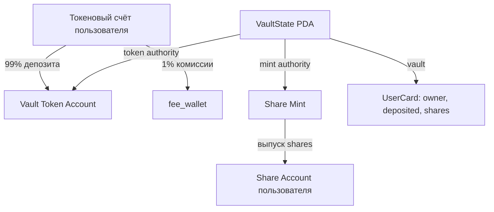
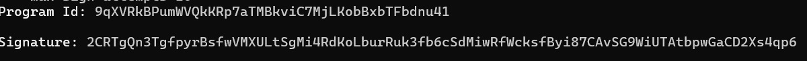
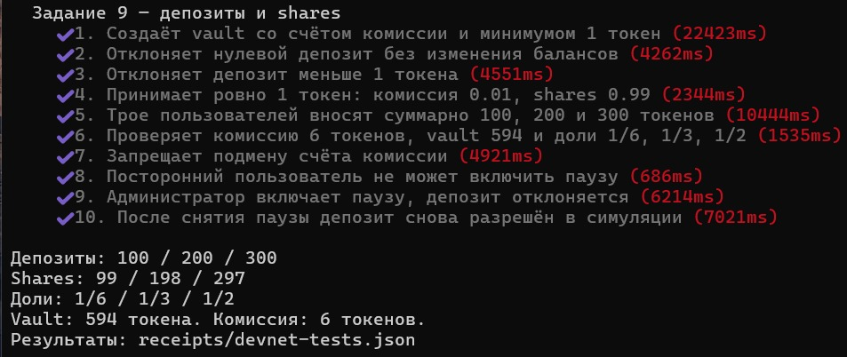

# Задание 9 — депозиты и share-токены

Учебная программа на Solana Devnet, Anchor 0.31.1.
Основа: [репозиторий преподавателя](https://github.com/0xnurda/vault-dev/tree/students-vault-card),
коммит `38db796`.

## Выполненные доработки

- Депозит SPL-токенов с выпуском share-токенов.
- Комиссия 1% переводится на токеновый счёт fee_wallet.
  Его адрес фиксируется при создании vault; подменить счёт при депозите нельзя.
- Минимальный депозит — 1 целый токен до удержания комиссии.
  Порог рассчитывается с учётом decimals выбранного mint.
- Администратор может включать и снимать паузу депозитов.
- Тесты проверяют депозиты трёх пользователей, комиссии и доли.

## Расчёт

Все суммы внутри программы хранятся в минимальных единицах токена.

```text
fee = amount / 100                 (целочисленно, округление вниз)
net_amount = amount - fee
первый депозит: shares = net_amount
следующие: shares = net_amount × total_shares / total_tokens
```

В карточке deposited учитывается внесённая сумма до комиссии.
В total_tokens учитывается сумма, поступившая в vault после комиссии.
Тестовый токен и share mint имеют 6 decimals.

## Результат проверки трёх пользователей

| Пользователь | Внесено | Комиссия | В vault | Shares | Доля |
|---|---:|---:|---:|---:|---|
| A | 100 | 1 | 99 | 99 | 1/6 |
| B | 200 | 2 | 198 | 198 | 1/3 |
| C | 300 | 3 | 297 | 297 | 1/2 |
| Всего | 600 | 6 | 594 | 594 | 1 |

Пользователь A сначала внёс 1 токен, затем 99.
Так отдельно проверяется приём минимальной допустимой суммы.

## Связи аккаунтов



| PDA | Seeds |
|---|---|
| VaultState | `vault`, token_mint |
| Vault Token Account | `vault_tokens`, token_mint |
| Share Mint | `share_mint`, token_mint |
| UserCard | `user_card`, vault_state, user |

## Аккаунты Devnet

| Аккаунт | Explorer |
|---|---|
| program | [9qXVRkBPumWVQkKRp7aTMBkviC7MjLKobBxbTFbdnu41](https://explorer.solana.com/address/9qXVRkBPumWVQkKRp7aTMBkviC7MjLKobBxbTFbdnu41?cluster=devnet) |
| admin | [GCELxq8keKXzd1Q27D9KzW5z2nw6JzLHyHH592okLfoy](https://explorer.solana.com/address/GCELxq8keKXzd1Q27D9KzW5z2nw6JzLHyHH592okLfoy?cluster=devnet) |
| tokenMint | [73eQUZGspfJsDZs8f3o84YzhScsv2voRgSJdt8bL2uzE](https://explorer.solana.com/address/73eQUZGspfJsDZs8f3o84YzhScsv2voRgSJdt8bL2uzE?cluster=devnet) |
| vaultState | [6pePQY7gSTXWqjA2uEQcSLTGx2pokrnhvp5UCBakyGXp](https://explorer.solana.com/address/6pePQY7gSTXWqjA2uEQcSLTGx2pokrnhvp5UCBakyGXp?cluster=devnet) |
| vaultTokenAccount | [2ZQSpGfDf1FVWME7umEdu11qdkjnLn7JnzHnSyDDF1ft](https://explorer.solana.com/address/2ZQSpGfDf1FVWME7umEdu11qdkjnLn7JnzHnSyDDF1ft?cluster=devnet) |
| shareMint | [HUvzqTvFcFHPAJQgqqX9uYjup1GTZXFTx6xXEHrji6v3](https://explorer.solana.com/address/HUvzqTvFcFHPAJQgqqX9uYjup1GTZXFTx6xXEHrji6v3?cluster=devnet) |
| feeWallet | [HnzW1yWkthVepwHHqAUoxWgiTfyk4iTrcUApRMW38c6f](https://explorer.solana.com/address/HnzW1yWkthVepwHHqAUoxWgiTfyk4iTrcUApRMW38c6f?cluster=devnet) |
| Пользователь 1: wallet | [DDWZAhQQG8jJ8ELFGvBXDTbWi2podsCTawrnS5LWJBQM](https://explorer.solana.com/address/DDWZAhQQG8jJ8ELFGvBXDTbWi2podsCTawrnS5LWJBQM?cluster=devnet) |
| Пользователь 1: card | [EyDwKWvusW14dmSffsPXNayNU4X1qMnaYCgvkfnq6MCm](https://explorer.solana.com/address/EyDwKWvusW14dmSffsPXNayNU4X1qMnaYCgvkfnq6MCm?cluster=devnet) |
| Пользователь 1: tokenAccount | [DaSgJXS6AADd6KmnYTeDDXqftrJ91hi82xEFeKG4G4JU](https://explorer.solana.com/address/DaSgJXS6AADd6KmnYTeDDXqftrJ91hi82xEFeKG4G4JU?cluster=devnet) |
| Пользователь 1: shareAccount | [9vP4sYX7bD5QCUVa8eVBEUg6v8rBjGChRGeSexEBkDeJ](https://explorer.solana.com/address/9vP4sYX7bD5QCUVa8eVBEUg6v8rBjGChRGeSexEBkDeJ?cluster=devnet) |
| Пользователь 2: wallet | [AakcA9zMFFBQtg69L8D9HJidUrJbZk6ganY8xLSsuz5p](https://explorer.solana.com/address/AakcA9zMFFBQtg69L8D9HJidUrJbZk6ganY8xLSsuz5p?cluster=devnet) |
| Пользователь 2: card | [CtQMej7ASfvXbaNoE5MBHbQamgB3AAko266epJWMj1ky](https://explorer.solana.com/address/CtQMej7ASfvXbaNoE5MBHbQamgB3AAko266epJWMj1ky?cluster=devnet) |
| Пользователь 2: tokenAccount | [5bkwM5JMooDKsohqkqn3gyBCzd3MY439V6vvMEvFKWF4](https://explorer.solana.com/address/5bkwM5JMooDKsohqkqn3gyBCzd3MY439V6vvMEvFKWF4?cluster=devnet) |
| Пользователь 2: shareAccount | [3F7kwSWvGy3omBWfS9xgwMqYV7aMchiDuVXJB6e7wHXQ](https://explorer.solana.com/address/3F7kwSWvGy3omBWfS9xgwMqYV7aMchiDuVXJB6e7wHXQ?cluster=devnet) |
| Пользователь 3: wallet | [GWsStt1bG9EZrYqLyaMMFGbsvgLTYZeu4cdTcwfYChKY](https://explorer.solana.com/address/GWsStt1bG9EZrYqLyaMMFGbsvgLTYZeu4cdTcwfYChKY?cluster=devnet) |
| Пользователь 3: card | [3xgegwQ1EaJ7uVmQdriKmzXP1JmUB1SJ8zFhkP9AWpdc](https://explorer.solana.com/address/3xgegwQ1EaJ7uVmQdriKmzXP1JmUB1SJ8zFhkP9AWpdc?cluster=devnet) |
| Пользователь 3: tokenAccount | [8JFJi91rXBkiA8iyZGfTZkHG52vPqCdicGSTtRGCJXDC](https://explorer.solana.com/address/8JFJi91rXBkiA8iyZGfTZkHG52vPqCdicGSTtRGCJXDC?cluster=devnet) |
| Пользователь 3: shareAccount | [AuAyioDioZwVfZykCitVv9sEn8LCR8DgtLsmQJnFMRQw](https://explorer.solana.com/address/AuAyioDioZwVfZykCitVv9sEn8LCR8DgtLsmQJnFMRQw?cluster=devnet) |

## Транзакции

| Действие | Explorer |
|---|---|
| Развёртывание | [Открыть](https://explorer.solana.com/tx/2CRTgQn3TgfpyrBsfwVMXULtSgMi4RdKoLburRuk3fb6cSdMiwRfWcksfByi87CAvSG9WiUTAtbpwGaCD2Xs4qp6?cluster=devnet) |
| initialize | [Открыть](https://explorer.solana.com/tx/WT9g45Zy38eYuLQnKFJAgDhfSZ3Jw3ebQuke3YEDGn6PNEeRbP7WadauQPWgJSsTr4kS3zxeAX7giengBZEHjbW?cluster=devnet) |
| card1 | [Открыть](https://explorer.solana.com/tx/4DH6jSUhL9yjvo7G7LjG88qvBiKZrfPsTUdhKrPx8mgFYB762xKtyWae7BvewfgwQohgC1Bv79c8XFzzS7M2tTB?cluster=devnet) |
| card2 | [Открыть](https://explorer.solana.com/tx/2v5AocNLZBsqUwosyDm5dASoiAFAvw8BZCpTK3cNr2ne4wquW4UWvXcfB1CsjN97F9ihLGWW5rCsN3N4J225cWyr?cluster=devnet) |
| card3 | [Открыть](https://explorer.solana.com/tx/CqjtY8caPDAQwLSsb9XQCXVHaj5bqjiUm3xXdiRiu22gNgkB1A3Ljn8LrPaveDwA2Bx6nATMRcRYXzyi4CANUdX?cluster=devnet) |
| minimum | [Открыть](https://explorer.solana.com/tx/qP5AcP7w6BTgrtKNBGddZmnF6NDMN9YNeazr5bhZPFNRXXkgPqnoaQiT6QLBbRLTnPBsMZEVbRUHaSP4TXqWvru?cluster=devnet) |
| depositA | [Открыть](https://explorer.solana.com/tx/cJkW1ihFsKf7iwdYzYGRxcbXb119FC8yFuwt2J4QAQ8w4XtDkQ5up2gWHZ1BdkF36gHQL73cpYyAwC2ya3pKDmY?cluster=devnet) |
| depositB | [Открыть](https://explorer.solana.com/tx/4wPPiLekyZ9vC7kCMkW4Wcn9nXrw2vkyT3qDYdJPxKfkP8wfDLsphqNrWkY28ZDmjq8N13XthH6CdVvm2RaYxpHc?cluster=devnet) |
| depositC | [Открыть](https://explorer.solana.com/tx/64ZEegxkgwu7ZCLY8Eq81sP7VLCYXaWuhbG1usCKmTR6M4uSbhj3oece52izgePhmxxxa8trby1Aygua5pZD7d7n?cluster=devnet) |
| pause | [Открыть](https://explorer.solana.com/tx/2z8Ajpv9hKNx22BuYRTptASjaeyWJ7GGbKjBTvNKKSuWYcWM4z3vE76Xm1C3GaULQUbdv4iUZpo4emZcT75w3BqB?cluster=devnet) |
| unpause | [Открыть](https://explorer.solana.com/tx/43MiCGGCnuukgmedqHy3BE4NBAD5dQfgA5LYsN87nELrvwruvRpZJwcisu5M19FToPSZTL4pTwhN1rwCMcDREGPb?cluster=devnet) |

## Проверки

Успешно выполнены `anchor build`, `yarn tsc --noEmit`
и 10 тестов Devnet:

1. Создание vault, установка счёта комиссии и минимального депозита.
2. Отклонение нулевой суммы.
3. Отклонение суммы меньше 1 токена.
4. Приём ровно 1 токена с комиссией 0.01.
5. Депозиты трёх пользователей.
6. Проверка 594 токенов в vault, комиссии 6 и долей по shares.
7. Запрет подмены счёта комиссии.
8. Запрет управления паузой посторонним пользователем.
9. Блокировка депозита во время паузы.
10. Успешная симуляция депозита после снятия паузы.

Последняя проверка не отправляет депозит в сеть, поэтому итоговые суммы
в таблице сохраняются. Она выполняется без проверки криптографических
подписей; реальные депозиты в тестах 4–5 отправляются с подписями.

Итог: **10 passing**. Адреса и подписи сохранены в
[receipts/devnet-tests.json](receipts/devnet-tests.json).

## Запуск

Нужны Rust, Solana CLI, Anchor 0.31.1, Node.js и Yarn 1.

```bash
yarn install --frozen-lockfile
anchor build
yarn tsc --noEmit
```

Для тестов нужен кошелёк с тестовыми SOL и RPC Devnet:

```bash
export ANCHOR_WALLET="$HOME/.config/solana/id.json"
read -r -s -p "Devnet RPC URL: " ANCHOR_PROVIDER_URL
echo
export ANCHOR_PROVIDER_URL
yarn run ts-mocha -p ./tsconfig.json -t 1000000 --exit tests/vault.ts
```

Каждый запуск создаёт новый тестовый mint и vault, расходует тестовые SOL
и обновляет receipts/devnet-tests.json.

Для развёртывания собственной программы сначала выполните
`anchor build`, затем `anchor keys sync` и повторно `anchor build`.
После этого разверните свою программу в Devnet.

## Скриншоты

### Развёртывание в Devnet



### Результаты тестирования


