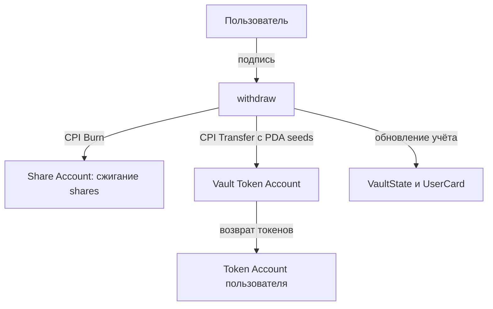
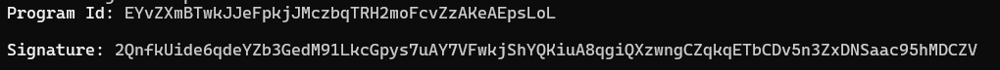
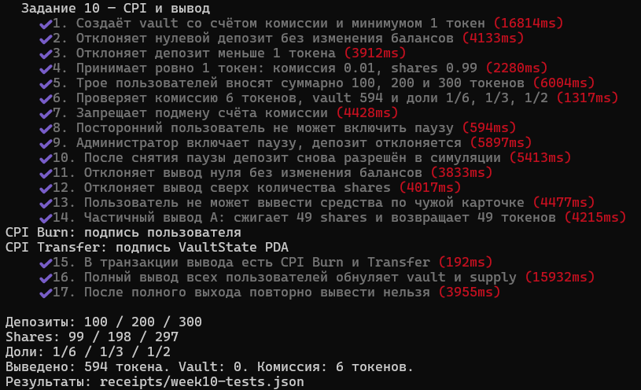

# Задание 10 — CPI и вывод из vault

Программа на Anchor 0.31.1, развёрнутая в Solana Devnet.
Основа — [моя работа за неделю 9](https://github.com/Kariyeva/week9-vault).

## Что добавлено

Инструкция withdraw принимает количество share-токенов для сжигания
и возвращает пользователю соответствующую долю токенов vault.

```text
amount = shares × total_tokens / total_shares
```

Расчёт целочисленный, с округлением вниз.
Умножение выполняется через u128, арифметические операции проверяются.

При выводе выполняются два CPI-вызова Token Program:
1. Burn — сжигание shares с подписью пользователя.
2. Transfer — перевод токенов из vault с подписью VaultState PDA.

После этого уменьшаются total_tokens, total_shares и shares в карточке.
Поле deposited остаётся историей всех внесённых сумм.

## Проверки доступа

- Нельзя вывести нулевое количество shares.
- Нельзя вывести больше shares, чем записано в карточке или есть на счёте.
- Карточка должна принадлежать пользователю и выбранному vault.
- Токеновые счета проверяются по mint и authority.
- Аккаунты vault и share mint проверяются по PDA seeds и сохранённым адресам.
- Нельзя выполнить вывод с нулевой выплатой или при недостатке ликвидности.

Комиссия 1% действует только на депозит. Комиссии за вывод нет.
Пауза блокирует депозиты, вывод остаётся доступным.

Учебное ограничение: право вывода связано и с карточкой, и с балансом shares.
Передача share-токенов сама по себе не переносит записи карточки другому
пользователю. Поддержка такого переноса требует доработки учёта.
Прямые переводы токенов в vault вне deposit не увеличивают total_tokens.

## Результат сценария

| Пользователь | Внесено | Комиссия | Получено shares | Выведено токенов |
|---|---:|---:|---:|---:|
| A | 100 | 1 | 99 | 49 + 50 |
| B | 200 | 2 | 198 | 198 |
| C | 300 | 3 | 297 | 297 |
| Всего | 600 | 6 | 594 | 594 |

После полного вывода:
- vault token balance = 0;
- total_tokens = 0;
- total_shares и supply share mint = 0;
- у всех пользователей shares = 0;
- на счёте комиссии осталось 6 токенов.

## CPI в транзакции вывода

[Открыть частичный вывод в Explorer](https://explorer.solana.com/tx/62CyNjdHCiZKNagqw1fiCm8o2N4tTJjXmShN15TyTv66zJAPso6shkqv8GA9sh2ZH8t62cRsT9c5uttj6LE5KkVr?cluster=devnet).

В разделе Instructions нужно раскрыть инструкцию withdraw
и её inner instructions. Видны два вызова SPL Token Program:

| CPI | Действие | Кто разрешает |
|---|---|---|
| Burn | Сжигает 49 shares | Пользователь подписывает транзакцию |
| Transfer | Возвращает 49 токенов из vault | Программа использует seeds и bump VaultState PDA |

Оба mint в тесте имеют 6 decimals, поэтому в инструкциях указано 49000000
минимальных единиц. У PDA нет приватного ключа: программа использует
CpiContext::new_with_signer. Подписи администратора недостаточно для
перевода из vault по этому сценарию.

Burn authority: `4bk3YY5Tyu1WUJ3eG5jzM8x3zzg4nSjpsNQfiyoQm8Rv`.

Transfer authority (PDA): `HKAoMadgEUP1FJuMXWc61eNfGrAWuRWair7bj5RHFFxa`.

Разбор фактических inner instructions сохранён в
[receipts/withdraw-cpi.json](receipts/withdraw-cpi.json).
Тест проверяет типы инструкций, суммы, источники, получателей и authority.

## Схема вывода



## Аккаунты Devnet

| Аккаунт | Explorer |
|---|---|
| program | [EYvZXmBTwkJJeFpkjJMczbqTRH2moFcvZzAKeAEpsLoL](https://explorer.solana.com/address/EYvZXmBTwkJJeFpkjJMczbqTRH2moFcvZzAKeAEpsLoL?cluster=devnet) |
| admin | [GCELxq8keKXzd1Q27D9KzW5z2nw6JzLHyHH592okLfoy](https://explorer.solana.com/address/GCELxq8keKXzd1Q27D9KzW5z2nw6JzLHyHH592okLfoy?cluster=devnet) |
| tokenMint | [CbreRGbGmvsXZWfPViA3tJZnfDTErsxhjq4q6zHM5fHz](https://explorer.solana.com/address/CbreRGbGmvsXZWfPViA3tJZnfDTErsxhjq4q6zHM5fHz?cluster=devnet) |
| vaultState | [HKAoMadgEUP1FJuMXWc61eNfGrAWuRWair7bj5RHFFxa](https://explorer.solana.com/address/HKAoMadgEUP1FJuMXWc61eNfGrAWuRWair7bj5RHFFxa?cluster=devnet) |
| vaultTokenAccount | [BSsgoFcHt2acnSoWkZYfSG7qm8oXhrCQes7q2aUT5Go8](https://explorer.solana.com/address/BSsgoFcHt2acnSoWkZYfSG7qm8oXhrCQes7q2aUT5Go8?cluster=devnet) |
| shareMint | [4tQ858VrnHTZDgdNDnWys79f48frovFmyvSRB2RW1KWB](https://explorer.solana.com/address/4tQ858VrnHTZDgdNDnWys79f48frovFmyvSRB2RW1KWB?cluster=devnet) |
| feeWallet | [Fpf2seXLCJHHgLuzTfVFqwbASopMc86PtGHdAi6Cjrgn](https://explorer.solana.com/address/Fpf2seXLCJHHgLuzTfVFqwbASopMc86PtGHdAi6Cjrgn?cluster=devnet) |
| Пользователь 1: wallet | [4bk3YY5Tyu1WUJ3eG5jzM8x3zzg4nSjpsNQfiyoQm8Rv](https://explorer.solana.com/address/4bk3YY5Tyu1WUJ3eG5jzM8x3zzg4nSjpsNQfiyoQm8Rv?cluster=devnet) |
| Пользователь 1: card | [8ePwXdzWnetVfSytb4nBug6YdWSjmcedcqyMQVW5pnKi](https://explorer.solana.com/address/8ePwXdzWnetVfSytb4nBug6YdWSjmcedcqyMQVW5pnKi?cluster=devnet) |
| Пользователь 1: tokenAccount | [GGMVDYCGyHJK3FYgZYvpjWiaZiuTH9GuDgYxKwzx3qLq](https://explorer.solana.com/address/GGMVDYCGyHJK3FYgZYvpjWiaZiuTH9GuDgYxKwzx3qLq?cluster=devnet) |
| Пользователь 1: shareAccount | [2zHYvs1Eokoti7B8UaYrjheXKeVnicCB6W2u5yMNjb3P](https://explorer.solana.com/address/2zHYvs1Eokoti7B8UaYrjheXKeVnicCB6W2u5yMNjb3P?cluster=devnet) |
| Пользователь 2: wallet | [7z5kNwLoDKbhY7vVSBbvMkrVj8exA4qbRZYF8BcwCPXn](https://explorer.solana.com/address/7z5kNwLoDKbhY7vVSBbvMkrVj8exA4qbRZYF8BcwCPXn?cluster=devnet) |
| Пользователь 2: card | [DAxkmVPS9bpUH3boVvNV3zL1Ak8jvczLmUaLnygYiv2x](https://explorer.solana.com/address/DAxkmVPS9bpUH3boVvNV3zL1Ak8jvczLmUaLnygYiv2x?cluster=devnet) |
| Пользователь 2: tokenAccount | [2J1SAT1tdL2gn398KojuhovSurRhemqzSV4WsozKHYby](https://explorer.solana.com/address/2J1SAT1tdL2gn398KojuhovSurRhemqzSV4WsozKHYby?cluster=devnet) |
| Пользователь 2: shareAccount | [3UyHPzzq1ifcFzN1Dr7kF7gi5pfgh2e9Dp2acYPCGz9w](https://explorer.solana.com/address/3UyHPzzq1ifcFzN1Dr7kF7gi5pfgh2e9Dp2acYPCGz9w?cluster=devnet) |
| Пользователь 3: wallet | [G2yb8s3ZKmAHZi6T26MF2DJ6yopiyPtpM32kDQF7wYDW](https://explorer.solana.com/address/G2yb8s3ZKmAHZi6T26MF2DJ6yopiyPtpM32kDQF7wYDW?cluster=devnet) |
| Пользователь 3: card | [2iDgH3hubS8DK1Hr416Ku2DD82doGEVHVqN2aMzxwmPp](https://explorer.solana.com/address/2iDgH3hubS8DK1Hr416Ku2DD82doGEVHVqN2aMzxwmPp?cluster=devnet) |
| Пользователь 3: tokenAccount | [ER2NmLhBwHkXdLgHTd3ZqsA118pcMFaCwCYktrBVsXfh](https://explorer.solana.com/address/ER2NmLhBwHkXdLgHTd3ZqsA118pcMFaCwCYktrBVsXfh?cluster=devnet) |
| Пользователь 3: shareAccount | [DNG75Gxn7XuMLngjLmC2yGgQk1uX17xN4197h2eMq7zf](https://explorer.solana.com/address/DNG75Gxn7XuMLngjLmC2yGgQk1uX17xN4197h2eMq7zf?cluster=devnet) |

## Транзакции

| Действие | Explorer |
|---|---|
| Развёртывание | [Открыть](https://explorer.solana.com/tx/2QnfkUide6qdeYZb3GedM91LkcGpys7uAY7VFwkjShYQKiuA8qgiQXzwngCZqkqETbCDv5n3ZxDNSaac95hMDCZV?cluster=devnet) |
| initialize | [Открыть](https://explorer.solana.com/tx/3qJbVLz1sNtdNwLMbTZjDqyncLk2D2Kti1tztzDyQaRuQXnxLt1ME6MpiRHzER1zK4jh5Ar6K8W2725MjfpQm4Qz?cluster=devnet) |
| card1 | [Открыть](https://explorer.solana.com/tx/4a2bHACsRnE88CTKmzsmnKJSxEuvV3RLomDbMb5c7UNNiYo3joNBJbxbZ5FdZCABeqBWZgCQihBz46RAaoDGWjYT?cluster=devnet) |
| card2 | [Открыть](https://explorer.solana.com/tx/4GPPaqhmQejjtJrH4pwd453TMxo79QCDVbje42ujqYSoD6KtwkmoR4UJJ9Cdx6XZEPfmPta8jgLTaJLPi3u8zwab?cluster=devnet) |
| card3 | [Открыть](https://explorer.solana.com/tx/CE47zCyURjCqW1UE98fQTaiHCjT7y6gf7Dw4EPSCJqmuRHWon3CnSAL9rNuLiSRqrzCpNDc7NvfT2Saiuvx75a2?cluster=devnet) |
| minimum | [Открыть](https://explorer.solana.com/tx/5zXFZce9MmWkXnq1aw6rSAATZVaYtzsx3hdKMkh8zXu6p7VaPF5koDJEaDmqRDfnfZ7SYYuAyNrAJA5p2FHCyh9Z?cluster=devnet) |
| depositA | [Открыть](https://explorer.solana.com/tx/aiFR5gNJW3H7x5Xz57tMASy8cQJGoNkjysRijnag2UmQK4vcKr4EfrSqgKu4CxTwoFfs6cMtv5WumZz2hKafZSZ?cluster=devnet) |
| depositB | [Открыть](https://explorer.solana.com/tx/47QBjvHu5x1mRAVVy1Fc8d7UJzbrjTPiPUdcE4Va1SpMcrX8hdGWDNUf8Vy7MMG1GGsBSp684LTPyQUiBYMT1eTH?cluster=devnet) |
| depositC | [Открыть](https://explorer.solana.com/tx/3mzwP17yuxQmMT2aJ7gAZF4h7TcMCeH4Y8Q8gC5GnAn4WQ3biCXdy5YjLP3cfBPixPEYuNMKCqmXGxv8KsHXYDTu?cluster=devnet) |
| pause | [Открыть](https://explorer.solana.com/tx/5aSXhwQuUSFsdMEjm295sPrdfxQRja4empCknsrokNf7gRRPazQZ4wMr2XGoKNSegjZgvS3HYA14qYFqx7XWPMd9?cluster=devnet) |
| unpause | [Открыть](https://explorer.solana.com/tx/4aeZ1MRn47eJUZHbw8D8AMydsaVT21DZ3dyvP5vdZdQgw4QPALGABjHznsURSFQ7MEeEqDYemnDym2KGQRJdtSUC?cluster=devnet) |
| withdrawPartial | [Открыть](https://explorer.solana.com/tx/62CyNjdHCiZKNagqw1fiCm8o2N4tTJjXmShN15TyTv66zJAPso6shkqv8GA9sh2ZH8t62cRsT9c5uttj6LE5KkVr?cluster=devnet) |
| withdrawRestA | [Открыть](https://explorer.solana.com/tx/5tj439rU1SrvTViPPTbVKxvwYBSPyRMYn2af3b6suNX8bkWQtvSYTGvBmB7EiCqgzP2QVnxCq3Wc3k3GrcJFAYj8?cluster=devnet) |
| withdrawB | [Открыть](https://explorer.solana.com/tx/3z4YdSa1LFqM35e9eWsENLA55CTgXQVxNXMjcLx8hyXvA7Z7BaUiNRaAhkLTpUjgKBURFvmJz88ZHaHg5tcjtmjb?cluster=devnet) |
| withdrawC | [Открыть](https://explorer.solana.com/tx/B5SZnps66qdaocxN4mbtS8cjhLMD7T4J2zQ12ZN1jfqdkhXe7QagHho3NMaR6MCnaJ6fvRUWdf45k7S6sr8qKgM?cluster=devnet) |

## Тесты

Успешно выполнены anchor build, yarn tsc --noEmit и **17 тестов Devnet**.

Проверки 1–10 покрывают создание vault, депозиты, комиссию 1%,
минимальный депозит, доли трёх пользователей, защиту счёта комиссии
и управление паузой. Разрешение депозита после снятия паузы
проверяется симуляцией без отправки транзакции.

Проверки 11–17 покрывают:
1. Запрет вывода нуля.
2. Запрет вывода сверх количества shares.
3. Запрет использования чужой карточки.
4. Частичный вывод с проверкой балансов, supply и учёта.
5. Наличие CPI Burn и Transfer в подтверждённой транзакции.
6. Полный выход трёх пользователей и обнуление vault.
7. Запрет повторного вывода после полного выхода.

Результаты текущего задания:
[receipts/week10-tests.json](receipts/week10-tests.json).

Файл receipts/devnet-tests.json и скриншоты week9 относятся к
предыдущей работе, сохранённой в истории проекта.

## Запуск

Нужны Rust, Solana CLI, Anchor 0.31.1, Node.js и Yarn 1.

```bash
yarn install --frozen-lockfile
anchor build
yarn tsc --noEmit
```

Для тестов нужен кошелёк с тестовыми SOL и RPC Devnet:

```bash
export ANCHOR_WALLET="$HOME/.config/solana/id.json"
read -r -s -p "Devnet RPC URL: " ANCHOR_PROVIDER_URL
echo
export ANCHOR_PROVIDER_URL
yarn run ts-mocha -p ./tsconfig.json -t 1000000 --exit tests/vault.ts
```

Каждый запуск создаёт новый тестовый mint и vault, выполняет депозиты
и выводы, расходует тестовые SOL и обновляет результаты задания 10.

Для развёртывания своей копии: anchor build, anchor keys sync,
повторно anchor build, затем deploy со своим program keypair.
Ключи и RPC с API-ключом в репозиторий не добавляются.

## Скриншоты задания 10

### Развёртывание в Devnet



### Результаты 17 тестов


